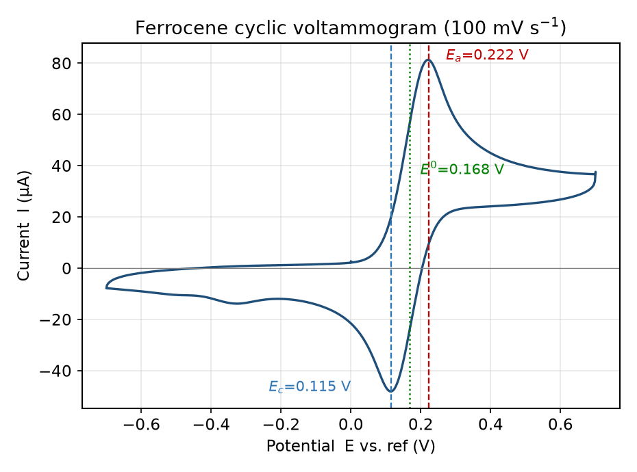
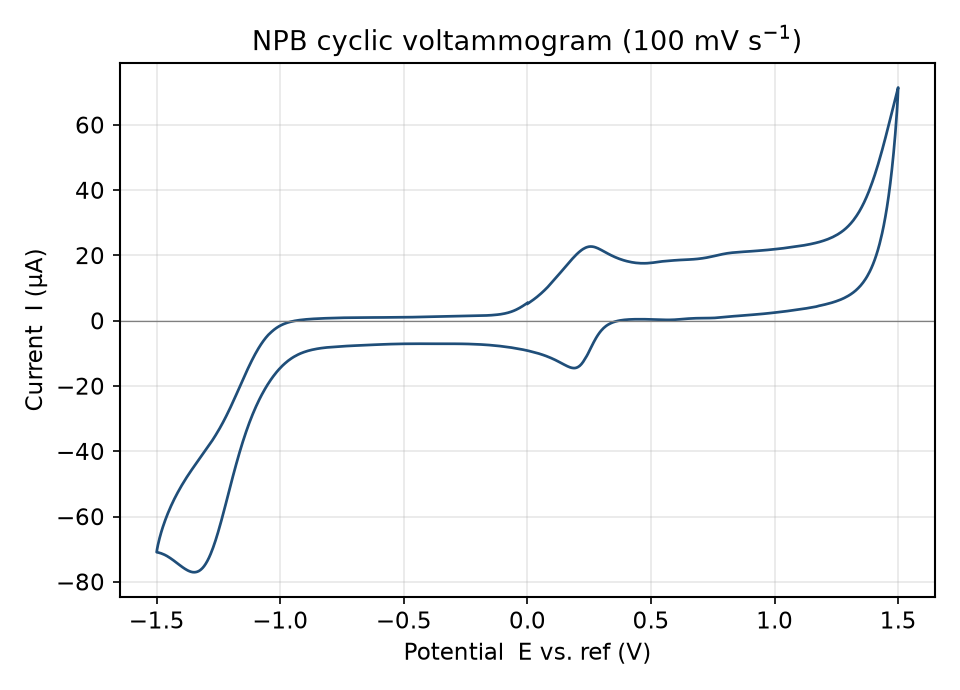
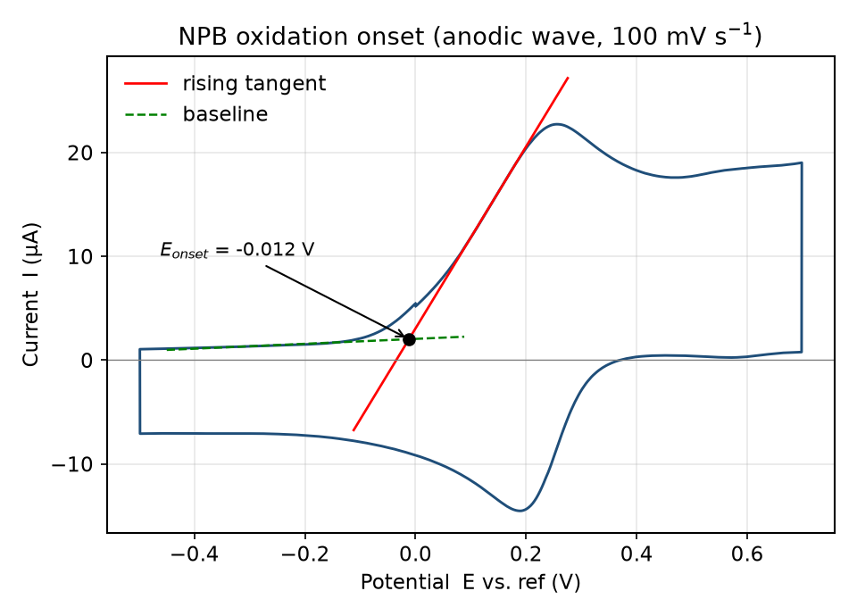
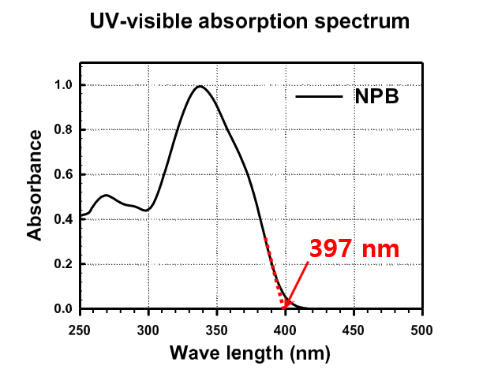
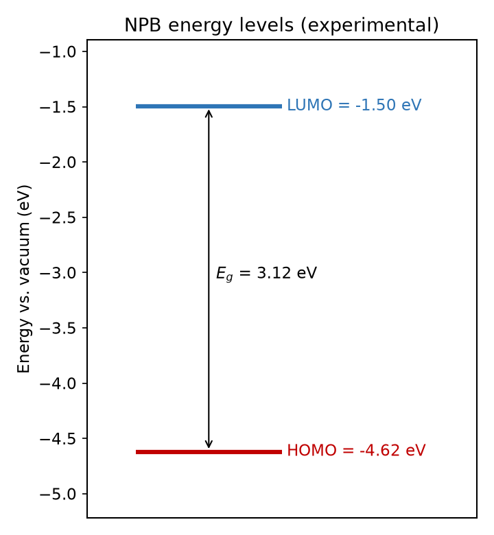
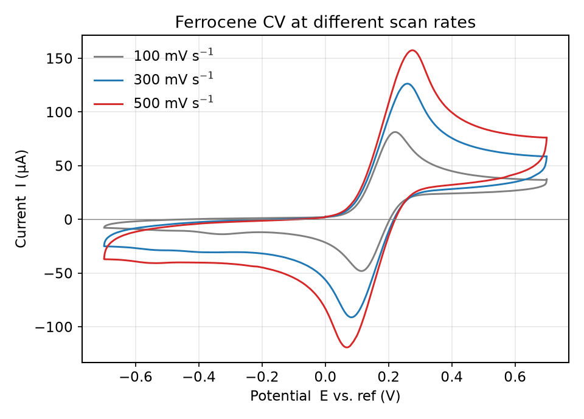
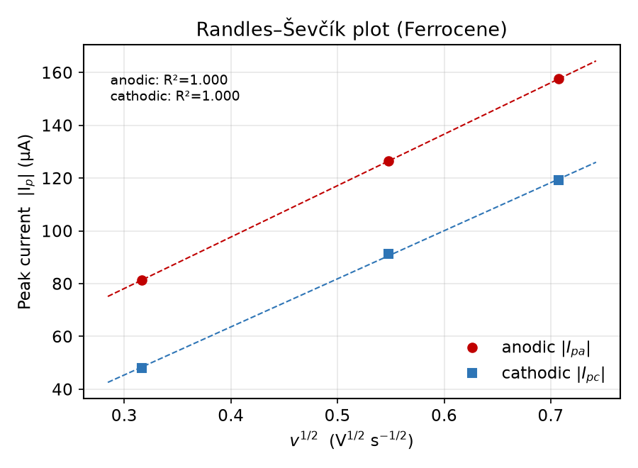

# OLED 실험 5주차 — Cyclic Voltammetry를 이용한 HOMO 준위 측정

**작성자:** 이영빈 **학번:** 2023101942

---

## Ⅰ. 실험 목적

- 3전극 전기화학 셀에서 수행되는 cyclic voltammetry(CV)의 작동 원리와 삼각파 전위 인가 방식을 이해한다.
- 전기화학적 기준물질인 ferrocene(Fc)을 이용하여 Fc/Fc⁺의 형식전위(formal potential) E°를 구하고, 이를 기준으로 유기 정공수송 물질 **NPB**의 산화 개시전위(oxidation onset potential)로부터 HOMO 준위를 산출한다.
- NPB의 UV–Vis 흡수 스펙트럼으로부터 optical band gap을 구하여 LUMO 준위까지 추정하고, 이를 문헌값과 비교한다.
- Scan rate를 100 / 300 / 500 mV s⁻¹로 바꾸어 측정한 ferrocene의 voltammogram을 비교하여, scan rate가 peak current와 가역성(reversibility)에 미치는 영향을 정량적으로 해석한다.

---

## Ⅱ. 실험 원리

### A. Cyclic voltammetry의 기본 개념

CV는 작업전극(working electrode, WE)의 전위를 기준전극(reference electrode, RE)에 대해 **시간에 따라 삼각파 형태로 선형 변화**시키면서, 그 사이에 흐르는 전류를 전위의 함수로 기록하는 기법이다. 설정한 switching potential에 도달하면 주사 방향이 반대로 바뀌므로, 한 번의 측정에서 산화(anodic)와 환원(cathodic) 과정을 모두 관찰할 수 있다. 이렇게 얻은 전류–전위 곡선이 cyclic voltammogram이다.

전위를 양(+)의 방향으로 올리면 WE 표면에서 물질이 산화되며 전류가 증가하다가, 전극 근방의 반응물이 소모되어 **확산에 의한 물질 공급 속도가 반응 속도를 따라가지 못하는 순간** 전류가 꺾여 peak를 형성한다. 유기 반도체에서 산화는 가장 높은 점유 준위(HOMO)에서 전자가 빠져나가는 과정이므로, **산화 개시전위는 HOMO 준위의 척도**가 된다. 반대로 환원 개시전위는 LUMO 준위와 대응된다.

### B. 3전극 구성이 필요한 이유

2전극 구성에서는 전류가 흐를 때 용액 저항에 의한 전압강하(iR drop)가 WE 전위에 섞여 들어가 정확한 전위 제어가 어렵다. 3전극 구성에서는

| 전극 | 역할 |
|------|------|
| Working electrode (WE) | 산화·환원 반응이 실제로 일어나는 전극. 비활성 금속(Pt 등) 사용 |
| Reference electrode (RE) | 전류가 거의 흐르지 않아 안정한 기준 전위를 공급 |
| Counter electrode (CE) | WE와 짝을 이뤄 전류 회로를 완성 |

RE에는 전류를 거의 흘리지 않으므로 iR drop의 영향을 분리할 수 있고, potentiostat가 WE–RE 사이 전위만 정밀하게 제어한다. 본 실험에서는 **Fc/Fc⁺를 내부 기준(internal reference)으로 삼아** 측정 조건이 달라져도 상대 전위로 환산할 수 있도록 한다.

### C. Scan rate와 확산층

scan rate `v`는 단위 시간당 전위 변화량(V s⁻¹)이다. 확산지배 가역계에서 peak current는 **Randles–Ševčík 식**을 따른다.

```
ip = 2.69×10⁵ · n^(3/2) · A · D^(1/2) · C · v^(1/2)   (25 ℃)
```

- n: 반응 전자 수, A: 전극 면적, D: 확산계수, C: 벌크 농도, v: scan rate

즉 가역 반응이면 **ip ∝ √v** 관계가 성립한다. scan rate가 빠를수록 확산층(diffusion layer)이 얇게 형성되어 농도 구배(∂C/∂x)가 커지므로 peak current가 증가한다. 한편 전자 전달 속도가 전위 변화 속도를 따라가지 못하면 산화·환원 peak 간격(ΔEp)이 벌어지며 가역에서 준가역(quasi-reversible) 거동으로 이동한다.

### D. Ferrocene 기준을 이용한 HOMO 산출

Fc의 voltammogram에서 산화 peak 전위 `Ea`와 환원 peak 전위 `Ec`의 평균을 Fc/Fc⁺의 형식전위로 쓴다.

```
E°(Fc) = (Ea + Ec) / 2
```

시료(NPB)의 산화 onset 전위 `Eonset`을 같은 기준전극에서 측정한 뒤, Fc/Fc⁺의 진공준위 환산값(-4.8 eV)을 이용해 HOMO를 구한다.

```
E_HOMO = -4.8 - (Eonset - E°(Fc))   [eV]
```

광학적 밴드갭은 흡수 onset 파장 λonset으로부터

```
Eg(opt) = 1240 / λonset [nm]   [eV]
```

이고, 두 값을 합치면 LUMO를 추정할 수 있다.

```
E_LUMO = E_HOMO + Eg(opt)
```

---

## Ⅲ. 실험 방법

### A. 기구 및 재료

| 구분 | 항목 |
|------|------|
| 측정 장비 | Cyclic voltammetry system(potentiostat), WE / CE / RE, UV–Vis spectrophotometer, 전자저울 |
| 시약 | Ferrocene(기준물질), NPB(시료), acetonitrile(용매), tetra-n-butylammonium perchlorate(TBAP, 지지전해질) |
| 소모품·기타 | magnetic bar / stirrer, alumina powder(polishing), micropipette, vial, 증류수 / acetone, 질소 가스 |

**주요 물질 물성(참고)**

| 물질 | 분자식 | 분자량 (g mol⁻¹) | 비고 |
|------|--------|------------------|------|
| Ferrocene | Fe(C₅H₅)₂ | 186.04 | HOMO ≈ -4.8 eV (기준) |
| NPB | C₄₄H₃₂N₂ | 588.74 | 문헌 HOMO/LUMO ≈ -5.4 / -2.3 eV |
| Acetonitrile | C₂H₃N | 41.05 | 용매 |
| TBAP | (C₄H₉)₄N·ClO₄ | 341.92 | 지지전해질 |

### B. 실험 과정

1. Acetonitrile 50 mL에 TBAP를 녹여 **0.10 M 지지전해질 용액**을 만든다. (0.10 mol L⁻¹ × 0.050 L × 341.92 g mol⁻¹ ≈ **1.71 g**의 TBAP가 필요하다.)
2. WE 표면을 alumina powder로 polishing한 뒤 증류수로 세척하고, ultrasonic bath에서 sonication하여 잔여물과 흡착물을 제거한다.
3. 셀에 전해질 용액을 담고 WE / CE / RE를 장착한 뒤, **질소로 약 10분간 purge**하여 용존 산소를 제거한다.
4. 전해질 20 mL에 ferrocene 4 mg을 녹여 −0.7 ~ +0.7 V 범위에서 scan rate를 **100 / 300 / 500 mV s⁻¹**로 바꾸며 CV를 측정한다.
5. Fc의 산화/환원 peak 전위(Ea, Ec)를 읽어 E°(Fc)를 계산한다.
6. 셀과 전극을 acetone·증류수로 세정한 뒤, 전해질 20 mL에 NPB 4 mg을 녹여 −1.0 ~ +1.5 V 범위에서 100 mV s⁻¹로 CV를 측정하고 oxidation onset을 결정한다.
7. UV–Vis 흡수 스펙트럼으로부터 NPB의 광학 밴드갭을 구하고, HOMO·Eg·LUMO를 산출하여 문헌값과 비교한다.

> **측정 조건 메모.** 본 보고서의 모든 수치는 실제 측정 raw data(`Ewe/V`, `<I>/mA`) 파일에서 직접 추출·계산한 값이며, peak 및 onset은 마지막 cycle(정상상태) 기준으로 읽었다.

---

## Ⅳ. 실험 결과

### ① Ferrocene의 형식전위 E°

100 mV s⁻¹에서 측정한 ferrocene의 voltammogram(마지막 cycle)에서 산화·환원 peak를 읽었다.

**Fig. 1 — Ferrocene cyclic voltammogram (100 mV s⁻¹)**



| 항목 | 값 |
|------|------|
| 산화 peak 전위 Ea | **+0.222 V** |
| 환원 peak 전위 Ec | **+0.115 V** |
| peak 간격 ΔEp = Ea − Ec | **107 mV** |
| 산화 peak 전류 Ipa | +81.3 µA |
| 환원 peak 전류 Ipc | −48.1 µA |

```
E°(Fc) = (Ea + Ec)/2 = (0.222 + 0.115)/2 = 0.168 V
```

가역 1전자 반응의 이론 peak 간격은 약 59 mV인데, 실측 ΔEp가 107 mV로 다소 크다. 이는 셀의 미보정 iR drop과 scan rate 유한성에 의한 것으로, 완전 가역보다는 가역에 가까운 준가역(quasi-reversible) 거동에 해당한다(세부 논의는 고찰 참조).

### ② NPB의 산화 onset 및 HOMO 준위

NPB의 anodic sweep에서 **E ≈ +0.26 V에 뚜렷한 산화 peak**가 나타난다(Ip ≈ +22.7 µA). 이 산화파의 상승부에 접선(tangent)을 긋고, 파 이전의 평탄한 배경선(baseline)과의 교점을 oxidation onset으로 정의하였다.

**Fig. 2 — NPB cyclic voltammogram (100 mV s⁻¹, 전체 구간)**



**Fig. 3 — NPB 산화 onset 작도 (산화파 확대)**



| 항목 | 값 |
|------|------|
| NPB 산화 peak 전위 Ep | +0.255 V |
| 배경선 | I ≈ 0.0024·E + 0.0020 (µA 환산) |
| 상승부 접선 | I ≈ 0.0876·E + 0.0031 |
| **산화 onset 전위 Eonset** | **≈ -0.012 V** |

Fc 기준으로 HOMO를 계산하면,

```
E_HOMO(NPB) = -4.8 - (Eonset - E°(Fc))
            = -4.8 - (-0.012 - 0.168)
            = -4.8 + 0.180
            ≈ -4.62 eV
```

### ③ UV–Vis 흡수로부터의 band gap과 LUMO

NPB 흡수 스펙트럼에서 흡수 가장자리(onset)는 약 **397 nm**이다.

**Fig. 4 — NPB UV–Vis absorption spectrum**



```
Eg(opt) = 1240 / 397 ≈ 3.12 eV
E_LUMO  = E_HOMO + Eg(opt) = -4.62 + 3.12 ≈ -1.50 eV
```

**Fig. 5 — 실험으로 추정한 NPB의 에너지 준위 다이어그램**



**Table 1 — NPB의 HOMO / LUMO / Band gap: 실험값 vs 문헌값**

| 준위 | 실험값 (eV) | 문헌값 (eV) | 오차 (%) |
|------|-------------|-------------|----------|
| HOMO | -4.62 | -5.4 | 14.4 |
| LUMO | -1.50 | -2.3 | 34.8 |
| Band gap | 3.12 | 3.1 | 0.6 |

Band gap은 문헌값과 거의 일치(오차 0.6%)하지만, HOMO·LUMO의 절대 위치는 문헌보다 얕게(덜 깊게) 나왔다. 그 원인은 고찰에서 분석한다.

### ④ Scan rate에 따른 Ferrocene CV 비교

100 / 300 / 500 mV s⁻¹에서 측정한 ferrocene의 voltammogram을 겹쳐 그렸다.

**Fig. 6 — Scan rate에 따른 Ferrocene voltammogram**



| Scan rate (mV s⁻¹) | Ea (V) | Ec (V) | ΔEp (mV) | Ipa (µA) | |Ipc| (µA) |
|:---:|:---:|:---:|:---:|:---:|:---:|
| 100 | 0.222 | 0.115 | 107 | 81.3 | 48.1 |
| 300 | 0.260 | 0.082 | 178 | 126.4 | 91.2 |
| 500 | 0.275 | 0.068 | 207 | 157.5 | 119.2 |

scan rate가 커질수록 **peak current가 증가**하고 **ΔEp가 벌어진다**. peak current가 √v에 비례하는지 확인하기 위해 Ip를 v^(1/2)에 대해 도시하였다.

**Fig. 7 — Randles–Ševčík plot (Ip vs. v^(1/2))**



| | 선형성 (R²) |
|------|------|
| 산화 peak (Ipa) | **0.9999** |
| 환원 peak (|Ipc|) | **0.9998** |

두 peak 모두 v^(1/2)에 대해 매우 높은 선형성(R² ≈ 1.00)을 보여 **ip ∝ √v** 관계가 성립함을 확인하였다. 즉 Fc/Fc⁺는 **확산지배(diffusion-controlled) 반응**으로 거동한다.

---

## Ⅴ. 고찰

**① 질소 purge를 수행한 이유.**
용존 산소는 전기화학적으로 환원되기 쉬워(O₂ → O₂⁻·, H₂O₂ 등) 측정 전위 구간에 배경 환원 전류를 더한다. 이는 특히 음의 전위에서 baseline을 왜곡하고 onset 판독에 오차를 준다. 따라서 측정 전 질소로 bubbling하여 셀 내 산소를 제거하면 재현성 있는 voltammogram을 얻을 수 있다.

**② 기준물질로 ferrocene을 사용한 이유.**
ferrocene은 Fe 원자를 두 cyclopentadienyl 고리가 샌드위치처럼 감싼 매우 안정한 구조로, Fc/Fc⁺ 산화·환원이 **빠르고 가역적(1전자)** 이며 산화 전후 구조 변화가 거의 없다. 그래서 IUPAC도 비수용매 전기화학의 내부 기준으로 권장한다. 본 실험에서 Fc는 ΔEp = 107 mV, Ipa/|Ipc| ≈ 1.7로 거의 가역에 가까운 거동을 보였다. Ipa/|Ipc|가 1보다 다소 큰 것은 산화종 Fc⁺의 역방향 환원 과정에서 일부 확산 손실이 있었음을 시사한다.

**③ ΔEp가 이론값(≈59 mV)보다 큰 이유.**
scan rate가 커질수록 ΔEp가 107 → 178 → 207 mV로 단조 증가한 점에 주목할 필요가 있다. 완전 가역계라면 ΔEp는 scan rate에 무관하게 ~59 mV로 일정해야 한다. ΔEp가 scan rate와 함께 커지는 것은 (ⅰ) 미보정 용액 저항에 의한 iR drop과 (ⅱ) 유한한 전자전달 속도가 복합적으로 작용하는 **준가역(quasi-reversible)** 특성의 전형적 징후이다. 다만 Ip가 √v에 거의 완벽히 비례(R² ≈ 1.00)하므로 물질 전달은 여전히 확산지배임을 알 수 있다.

**④ HOMO·LUMO가 문헌값보다 얕게 나온 이유 (오차 분석).**
Band gap은 광학 측정이 흡수 onset만 보면 되므로 문헌과 거의 일치(3.12 vs 3.1 eV)한 반면, HOMO·LUMO의 절대 위치는 문헌보다 약 0.7~0.8 eV 얕게 나왔다. 주요 원인은 다음과 같이 분석된다.

- **onset 판정 기준의 민감도.** NPB의 산화파가 넓고 완만하여 baseline–tangent 작도에서 교점이 scan 방향·구간 선택에 민감하다. 본 측정의 Eonset(≈ -0.012 V)은 매우 낮게 잡혔고, 이는 HOMO를 얕은 쪽으로 밀어 올린다.
- **기준전극 환산의 불확실성.** HOMO 공식은 Fc/Fc⁺를 내부 기준으로 삼아 상대 전위만 쓰도록 되어 있다. 만약 Fc와 NPB 측정 시 기준 전위가 미세하게 drift했다면 절대 HOMO에 계통오차가 생긴다.
- **배경·double-layer 전류의 중첩.** NPB의 산화파가 지지전해질/용매의 산화 배경과 겹쳐 전류가 부풀면 onset이 실제보다 낮게 읽힌다. 실제로 +1.3 V 이상에서 전류가 급증하는데, 이는 NPB 산화가 아니라 solvent window 한계(배경 산화)로, 이 영역을 onset으로 잘못 잡으면 반대로 HOMO가 과도하게 깊어진다. 본 보고서는 **E ≈ 0.26 V의 NPB 고유 산화파**를 기준으로 삼아 이 혼동을 피했다.
- **LUMO 오차의 전파.** LUMO는 HOMO에 광학 Eg를 더해 간접 추정하므로 HOMO 오차가 그대로 전파된다. 따라서 LUMO 오차(약 35%)가 HOMO 오차보다 큰 것은 자연스러운 결과이다.

개선 방향으로는, (ⅰ) Fc를 NPB 용액에 **직접 첨가(spiking)** 하여 동일 측정 내에서 Fc/Fc⁺ 기준을 확정하는 것, (ⅱ) onset 판정을 전류 밀도 기준(예: 특정 임계 전류)으로 통일하는 것, (ⅲ) iR 보정을 적용하는 것이 효과적이다.

---

### 부록 — 데이터 처리 요약

- 원본 데이터: `5주차 CV data/`의 `Ferrocene 100/300/500_C01.txt`, `NPB 100.txt` (열: `Ewe/V`, `<I>/mA`, `cycle number`)
- peak: 마지막 cycle의 최대/최소 전류점에서 Ea·Ec, Ipa·Ipc 추출
- onset: baseline(파 이전 평탄부) 선형회귀 × 산화파 상승부 접선의 교점
- band gap: 흡수 onset 파장 397 nm → 1240/λ 환산
- 모든 그래프는 raw data로부터 Python(numpy/matplotlib)으로 직접 작성
