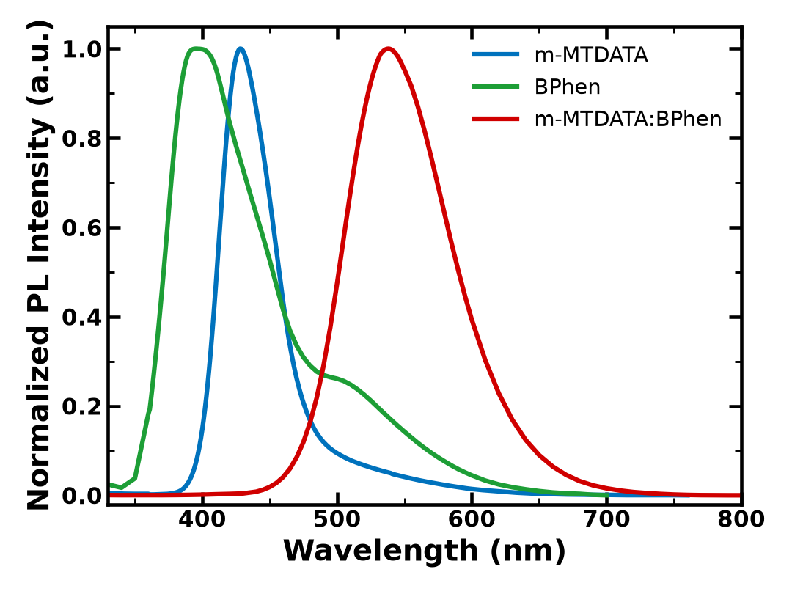
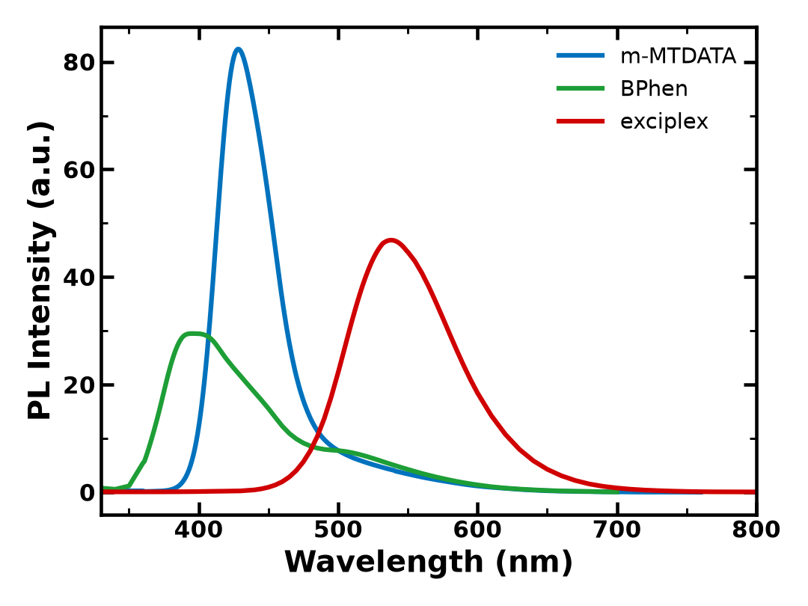
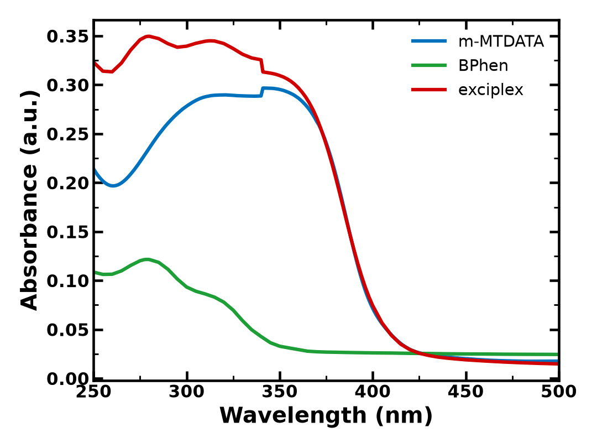
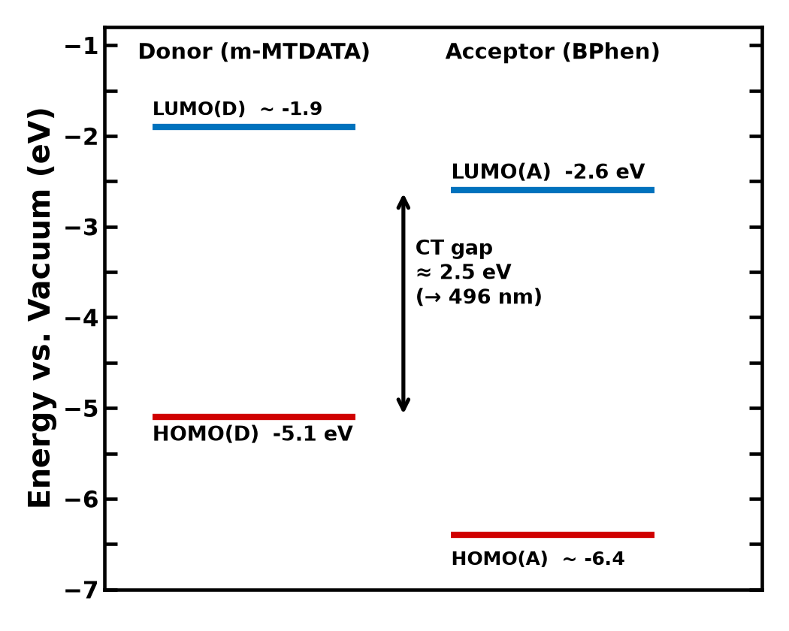

# OLED 실험 6주차 — Exciplex

**작성자:** 이영빈 **학번:** 2023101942

> 측정 시료: **m-MTDATA(전자주개, donor) / BPhen(전자받개, acceptor) / m-MTDATA:BPhen(1:1, exciplex)**
> 측정: UV–Vis 흡수(absorption), 광발광(photoluminescence, PL, λex = 280 nm)

---

## Ⅰ. 실험 목적

- 전자주개(electron donor)와 전자받개(electron acceptor) 두 이종 유기물이 혼합·접촉할 때 형성되는 **charge-transfer(CT) 상태**와 그에 따른 **exciplex 발광**을 이해한다.
- m-MTDATA와 BPhen 각각의 단일 박막, 그리고 두 물질을 1:1로 혼합한 박막의 흡수·발광 스펙트럼을 측정·비교하여 exciplex 생성을 실험적으로 확인한다.
- Exciplex 발광 peak의 λmax·모양을 단일 물질과 비교하고, exciplex의 bandgap이 HOMO(donor)–LUMO(acceptor) 차이와 일치하는지 검증한다.
- 열증착 공정에서 **tooling factor**의 의미를 이해하고, 목표 두께와 실제 두께의 비로부터 보정 tooling factor를 산출한다.

---

## Ⅱ. 실험 원리

### A. Donor–Acceptor와 charge-transfer complex

유기 반도체에는 전자를 내주기 쉬운 **donor**(보통 정공수송재료, 상대적으로 얕은 HOMO)와 전자를 받기 쉬운 **acceptor**(보통 전자수송재료, 상대적으로 깊은 LUMO)가 있다. 이 둘이 혼합·접촉하면 경계에서 donor의 HOMO 전자가 acceptor의 LUMO 쪽으로 부분적으로 이동한 **부분 전하이동(partial charge transfer) 상태**가 만들어진다. 두 분자가 한 쌍처럼 거동하며 단일 물질에 없던 새로운 광학적 특성을 보이는데, 이를 charge-transfer complex라 하고 이때 새로운 흡수(CT absorption)나 발광(exciplex emission)이 나타난다.

### B. Exciplex vs excimer

- **Excimer**: 들뜬 분자가 **같은 종류**의 바닥상태 분자와 결합한 들뜬 이합체.
- **Exciplex(excited complex)**: **서로 다른 종류**(donor·acceptor)의 분자 사이에서 형성되는 들뜬 상태 복합체.

Exciplex emission의 특징은 (ⅰ) 단일 물질보다 **장파장(저에너지)** 에서 나타나고, (ⅱ) **broad**하며, (ⅲ) **진동 구조(vibronic structure)가 거의 없는** 매끄러운 single peak라는 점이다. CT 상태가 공유결합이 아닌 느슨한 쿨롱 상호작용으로 묶여 있어 뚜렷한 진동 모드를 갖지 않고, donor·acceptor보다 안정한(에너지가 낮은) 새 상태를 만들기 때문이다.

### C. Exciplex의 bandgap과 HOMO–LUMO

Exciplex의 발광 에너지(= CT 상태의 에너지, exciplex의 bandgap)는 근사적으로 donor의 HOMO와 acceptor의 LUMO 사이 에너지 차로 설명된다.

```
E(exciplex) ≈ | E_HOMO(donor) − E_LUMO(acceptor) | − E_b
            (E_b: CT 상태의 쿨롱 결합·완화에 의한 안정화 에너지)
```

따라서 발광 λmax를 에너지로 환산(E[eV] = 1240 / λ[nm])하여 HOMO(D)−LUMO(A) 값과 비교하면 exciplex 형성 여부와 CT 특성을 판정할 수 있다.

### D. 열증착과 QCM, tooling factor

유기 박막은 진공 중에서 가열·기화시켜 기판에 쌓는 **열증착(thermal evaporation)** 으로 제작한다. 이때 증착 두께는 **QCM(quartz crystal microbalance)** 센서로 실시간 모니터링한다. 그러나 센서와 기판의 위치·각도가 달라 센서가 읽는 두께와 실제 기판 두께가 어긋나므로, 그 비율을 보정하는 상수가 **tooling factor**다.

```
보정 tooling factor = 초기 tooling factor × (실제 측정 두께 / 목표(설정) 두께)
```

---

## Ⅲ. 실험 방법

### A. 기구 및 재료

| 구분 | 항목 |
|------|------|
| 측정 장비 | Photoluminescence spectrometer(JASCO FP-8550), UV/VIS spectrophotometer(JASCO V-750), Thermal evaporator, Alpha-step(두께 측정) |
| 시료 | m-MTDATA(donor), BPhen(acceptor), bare glass(기판) |

### B. 실험 과정

1. donor(m-MTDATA)와 acceptor(BPhen)를 준비한다.
2. thermal evaporator로 증착한 뒤 실제 두께를 측정하여 **tooling factor**를 보정한다.
3. m-MTDATA 단일 박막, BPhen 단일 박막을 각각 제작한다.
4. m-MTDATA:BPhen = 1:1 혼합(공증착) 박막을 제작한다.
5. 3종 박막의 **absorption**과 **photoluminescence(λex = 280 nm)** 를 측정한다.
6. 각 스펙트럼의 peak 파장을 비교하여 exciplex 생성을 확인한다.

---

## Ⅳ. 실험 결과 (Result)

### 1. 박막의 두께를 측정하여 tooling factor를 구하시오.

QCM 센서가 가리키는 두께(목표값)와 Alpha-step으로 실측한 실제 두께가 다르므로, 두 값의 비로 tooling factor를 보정한다.

- 초기 tooling factor = **23.7 %**
- 목표(설정) 두께 = **800 Å**
- 실제 측정 두께 = **600 Å**

```
보정 tooling factor = 초기 tooling factor × (실제 두께 / 목표 두께)
                    = 23.7 × (600 / 800)
                    = 23.7 × 0.75
                    = 17.775 ≈ 17.8 %
```

실제 두께(600 Å)가 목표(800 Å)보다 **작게** 증착되었다는 것은, 센서가 실제보다 두께를 **과대평가**하여 목표에 일찍 도달했다고 판단해 증착을 조기에 멈췄음을 의미한다. 따라서 tooling factor를 **23.7 % → 17.8 %로 낮춰** 다음 증착부터 센서 지시 두께와 실제 기판 두께가 일치하도록 보정한다.

### 2. Exciplex spectrum의 peak의 λmax와 peak 모양을 각각의 단일 물질의 spectrum과 비교하시오.

**Fig. 1 — 3종 박막의 PL 스펙트럼 (정규화, λex = 280 nm)**



**Fig. 2 — 3종 박막의 PL 스펙트럼 (원시 강도)**



| 시료 | PL λmax | FWHM(반치폭) | peak 모양 |
|------|:-------:|:-----------:|-----------|
| m-MTDATA (donor) | **428 nm** | 약 46 nm | 비교적 좁은 단일 peak |
| BPhen (acceptor) | **396 nm** | 약 81 nm | 다소 넓은 peak |
| **m-MTDATA:BPhen (exciplex)** | **538 nm** | 약 89 nm | 매우 broad, 진동 구조 없는 매끄러운 single peak |

**λmax 비교.** 혼합 박막의 PL peak(538 nm)는 두 단일 물질(m-MTDATA 428 nm, BPhen 396 nm)보다 **약 110~140 nm 장파장(저에너지)으로 크게 적색 이동(red shift)** 했다. 이 발광은 단일 물질 PL의 단순 중첩으로는 설명되지 않는 **완전히 새로운 위치의 peak**이다. 즉 두 단일 물질 어디에도 없던 새로운 발광종 — donor의 HOMO와 acceptor의 LUMO 사이에서 전하이동으로 생성된 **exciplex(CT 상태) emission** — 이 형성되었음을 보여준다. exciplex가 donor·acceptor 각각의 들뜬상태보다 에너지가 낮은 안정한 상태이므로, 그 발광이 가장 긴 파장에서 관측되는 것이다.

**peak 모양 비교.** 단일 물질은 상대적으로 특징적인 발광 형태를 보이는 반면, exciplex peak는 **FWHM이 가장 넓고(약 89 nm)**, 어깨(shoulder)나 진동 구조가 보이지 않는 **대칭에 가까운 매끄러운 Gaussian형 single peak**이다. 이러한 broad하고 구조 없는 형태는 exciplex 발광의 전형적 특징이며(자세한 이유는 Discussion 2번), Fig. 1에서 빨간 곡선이 이를 명확히 보여준다.

### 3. Exciplex의 bandgap과 HOMO(Donor)–LUMO(Acceptor) 값과 일치하는지 비교하시오.

**Fig. 3 — 3종 박막의 UV–Vis 흡수 스펙트럼**



**Fig. 4 — Exciplex의 charge-transfer 에너지 다이어그램**



exciplex의 bandgap은 CT 상태의 에너지에 해당하므로, exciplex 발광 λmax를 에너지로 환산해 구한다.

```
E(exciplex, bandgap) = 1240 / λmax = 1240 / 538 ≈ 2.30 eV
```

이를 donor의 HOMO와 acceptor의 LUMO 차이와 비교한다.

- HOMO(m-MTDATA, donor) ≈ **-5.1 eV**, LUMO(BPhen, acceptor) ≈ **-2.6 eV** (문헌 근사값)

```
| HOMO(D) − LUMO(A) | = | -5.1 − (-2.6) | = 2.5 eV  (→ 파장 환산 약 496 nm)
```

| 항목 | 값 |
|------|------|
| Exciplex bandgap (PL λmax 538 nm 환산) | 약 **2.30 eV** |
| HOMO(D) − LUMO(A) 기대값 | 약 **2.50 eV** |
| 차이 | 약 0.20 eV |

**해석.** 실험으로 얻은 exciplex bandgap(≈ 2.30 eV)은 HOMO(D)−LUMO(A)로 예상되는 CT gap(≈ 2.50 eV)과 **같은 수준으로 잘 일치**한다. 발광 에너지가 CT gap보다 약 0.2 eV **낮게** 나온 것은, exciplex가 형성된 뒤 CT 상태의 쿨롱 인력에 의한 안정화와 구조 완화(relaxation)만큼 에너지가 더 내려간 상태에서 발광하기 때문이다. 이 작은 차이(안정화 에너지)는 exciplex 발광이 단일 분자 발광이 아니라 **donor–acceptor 간 전하이동 발광**임을 뒷받침한다. 결론적으로 exciplex의 bandgap은 HOMO(donor)−LUMO(acceptor) 값과 잘 일치하며, 그 차이는 CT 상태의 결합 안정화로 설명된다.

---

## Ⅴ. 고찰 (Discussion)

### 1. QCM 센서에 대해 설명하시오.

QCM(Quartz Crystal Microbalance, 수정진동자 미량저울)은 **AT-cut 수정 결정의 공진 주파수가 표면에 쌓인 질량만큼 감소**하는 성질을 이용한 질량/두께 센서다. 수정에 교류 전압을 걸면 역압전 효과로 고유 공진 주파수(수 MHz)로 진동하는데, 증착 물질이 결정 표면에 쌓이면 유효 질량이 늘어 공진 주파수가 낮아진다. 얇고 단단한 막에서는 **Sauerbrey 식**에 따라 주파수 변화가 단위면적당 질량 변화에 선형 비례한다.

```
Δf = − (2 f₀² / (A·√(ρq·μq))) · Δm
   (f₀: 기본 공진주파수, A: 전극 면적, ρq·μq: 수정의 밀도·전단탄성률)
```

증착기는 이 Δf를 측정해 센서 위치의 증착 두께와 증착 속도(rate)를 실시간 계산한다. 다만 QCM은 기판과 다른 위치·각도에 있어 센서가 받는 증착량과 실제 기판 증착량이 다르므로, 그 차이를 **tooling factor로 보정**해 센서 지시값을 실제 기판 두께에 맞춘다. 본 실험의 tooling 보정(23.7 % → 17.8 %)이 바로 이 과정이며, 이렇게 보정해야 이후 단일/혼합 박막을 원하는 두께로 정확히 증착할 수 있다.

### 2. Exciplex의 발광 스펙트럼에서 vibrational peak이 뚜렷하게 나타나지 않는 이유를 생각해보시오.

일반적인 단분자 발광에서는 전자가 들뜬상태에서 바닥상태의 여러 **진동 준위(vibrational level)** 로 떨어지면서, 서로 다른 전이가 어깨처럼 겹친 **vibronic(진동-전자) peak** 구조가 나타난다. 그러나 exciplex 발광에서는 이러한 진동 구조가 거의 보이지 않는데, 그 이유는 다음과 같다.

- **발광종이 단단한 단일 분자가 아니다.** exciplex 발광은 donor의 HOMO와 acceptor의 LUMO 사이의 **전하이동(CT) 전이**로, 발광이 일어나는 상태가 공유결합으로 결합된 하나의 분자가 아니라 **두 분자가 느슨한 쿨롱 상호작용으로 묶인 복합체**이다. 따라서 바닥상태에 뚜렷하게 양자화된 진동 모드가 정의되지 않아 특정 vibronic 전이가 선명하게 나타나지 않는다.
- **구조적 분포(inhomogeneity)가 크다.** donor–acceptor 쌍의 상대 거리·배향이 연속적으로 분포하므로, 각 쌍마다 CT 발광 에너지가 조금씩 달라진다. 이들이 겹쳐 전체 스펙트럼이 넓게 퍼지고(평탄화, smearing) 세부 진동 구조가 묻힌다.
- **환경 요동과 완화.** CT 상태는 주변 분자의 분극(polarization)에 민감해 발광 에너지가 요동치고, 발광 전 구조 완화가 커 스펙트럼이 더욱 broad해진다.

그 결과 exciplex PL은 날카로운 vibronic peak 없이 **broad하고 매끄러운 single Gaussian형 peak**로 나타난다. 실제 Fig. 1에서 exciplex(538 nm, FWHM ≈ 89 nm) 곡선은 단일 물질보다 넓고 구조가 없는 매끄러운 형태를 보여, 이 설명과 일치한다.

### 3. Exciplex에서 지연발광이 나타날 수 있는 이유를 서술하고, TADF 물질과 exciplex의 차이를 비교하시오.

**지연발광이 나타날 수 있는 이유.** exciplex에서는 정공(donor HOMO)과 전자(acceptor LUMO)가 **공간적으로 서로 다른 분자에 분리**되어 있다. 이 공간 분리는 두 전자 사이의 교환 상호작용(exchange interaction)을 작게 만들고, 그 결과 **일중항 CT 상태(¹CT)와 삼중항 CT 상태(³CT)의 에너지 차 ΔE(S₁–T₁)가 매우 작아진다**(수십 meV 이하). ΔE가 상온 열에너지(kT ≈ 26 meV) 수준으로 작으면, 삼중항(T₁)에 모인 여기자가 열에너지를 받아 다시 일중항(S₁)으로 **역계간전이(RISC, Reverse InterSystem Crossing)** 할 수 있다. 이후 S₁ → S₀로 발광하는데, 이 경로는 즉시발광(prompt fluorescence)보다 시간이 더 걸리므로 **지연형광(delayed fluorescence)** 으로 관측된다. 즉 exciplex는 그 자체로 **열활성 지연형광(TADF, Thermally Activated Delayed Fluorescence) 메커니즘**을 보일 수 있으며, 이를 통해 원래는 발광에 쓰이지 못하는 삼중항 여기자까지 발광에 활용할 수 있다.

**TADF 물질과 exciplex의 차이.**

| 구분 | TADF 단분자 | Exciplex |
|------|-------------|----------|
| CT 상태의 공간 규모 | **분자 내(intramolecular)** D–A 구조 | **분자 간(intermolecular)** 서로 다른 두 분자 사이 |
| 작은 ΔE(S₁–T₁) 확보 방식 | donor·acceptor를 비틀어(dihedral twist) HOMO–LUMO 공간 중첩을 줄이는 정교한 **분자 설계**로 구현 | 두 분자가 공간적으로 떨어져 있어 **본질적으로** 작은 ΔE를 가짐 |
| 발광 스펙트럼 | 상대적으로 좁음 | 매우 broad, 진동 구조 없음 |
| 색 조절 방식 | 분자 구조 자체로 조절 | donor/acceptor 조합·혼합비로 조절 |
| 주요 용도 | 발광 도판트(emitter) | host나 보조 발광/전하 균형층 등 |

핵심 차이는 **CT가 한 분자 안에서 일어나느냐(TADF), 서로 다른 두 분자 사이에서 일어나느냐(exciplex)** 이다. 두 경우 모두 작은 ΔE(S₁–T₁) 덕분에 RISC를 통한 지연형광이 가능하여 삼중항 여기자를 발광에 활용할 수 있다는 공통점이 있지만, exciplex는 분자 간 CT라 발광이 더 broad하고 조성·형태에 민감한 반면, TADF 단분자는 분자 설계로 특성을 보다 정밀하게 제어할 수 있다.

---

### 부록 — 데이터 처리 요약

- 측정 기기: PL(JASCO FP-8550, λex 280 nm, 300–800 nm), UV–Vis(JASCO V-750, 250–500 nm)
- λmax: PL 스펙트럼에서 330 nm 이상 영역의 최대 강도 파장
- FWHM: 최대 강도의 절반 높이에서 좌/우 교차점을 선형 보간하여 산출
- 에너지 환산: E[eV] = 1240 / λ[nm]
- 모든 그래프는 측정 raw CSV로부터 Python(numpy/matplotlib)으로 직접 작성
- 문헌 에너지 준위(m-MTDATA HOMO ≈ -5.1 eV, BPhen LUMO ≈ -2.6 eV)는 근사 비교용 참고값
